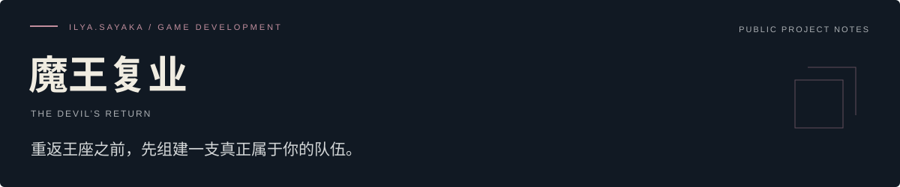
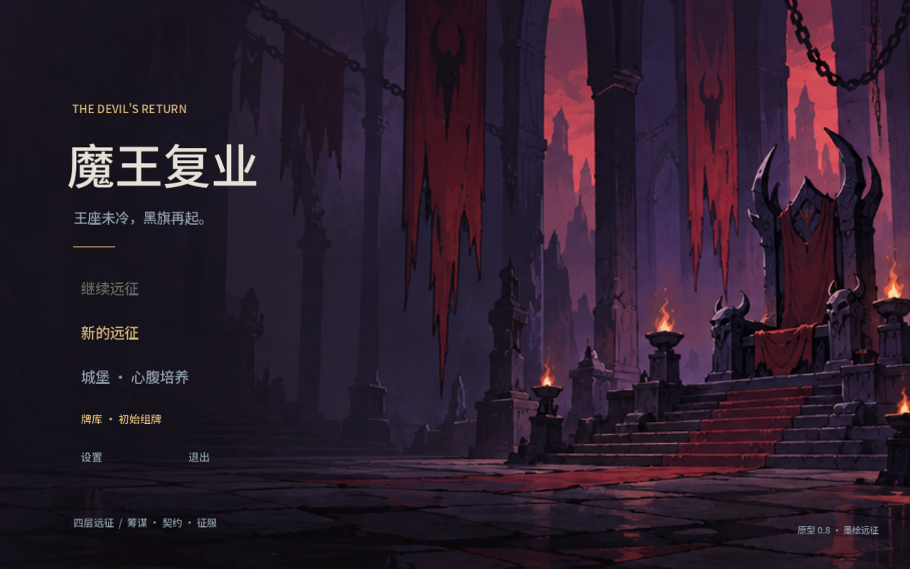

<!-- ilya-showcase:v1 -->

[游戏介绍](#游戏介绍) · [开发进度](./PROGRESS.md) · [画面说明](./MEDIA.md) · [开发者](https://github.com/YDZ-syj)

**队伍构筑与策略卡牌**　/　可玩原型 v0.32 · 持续迭代

## 游戏介绍

一款以魔王亲征、招募手下与角色招式配合为方向的中文策略卡牌游戏原型。玩家在远征中收集伙伴与招式，调整队伍与携带选择，通过回合制战斗推进旅程。

## 想带来的体验

- 角色与各自招式共同参与队伍构筑。
- 在远征中招募、收集与整备，尝试不同成员的配合。
- 战斗强调敌方意图、时机选择与队伍之间的协作。
- 二维手绘角色与路线地图呈现魔王重新出发的旅程。

## 开发画面

早期标题界面存档，保留当时的版本标记；仅展示视觉方向。当前原型进度以 v0.32 文字记录为准。

## 当前进度

- 目前可玩原型版本为 v0.32。
- 魔王出战、手下招募、队伍调整与专属招式已有实现。
- 已有路线选择、战后收获与节点间整备流程。
- 近期迭代覆盖混编队伍体验与前段旅程节奏。
- 已有前两章验证与开发画面记录。

**正在关注：** 继续打磨队伍构筑、招式可读性与战斗节奏。 验证不同队伍选择带来的实际体验，持续修订原型。

详细阶段记录见 [开发进度](./PROGRESS.md)。

## 后续与试玩

现有设计稿不等于已实现内容。当前仍为原型，平衡、角色表现与旅程内容都在迭代；没有公开发售日期。

可公开的试玩信息与重要进展会在本仓库更新。欢迎通过 [Issues](https://github.com/YDZ-syj/devils-return-showcase/issues) 留下体验建议或交流意向。商务合作请勿在公开 Issue 中提交私人联系方式或保密材料。

---

**ilya.sayaka** · 游戏开发者 / 工作室筹备中  
本仓库用于介绍游戏与记录进度；游戏工程保持私有。  
最近整理：2026-10-18。
